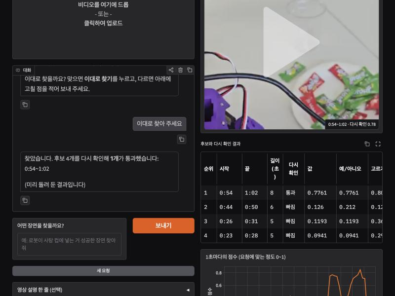
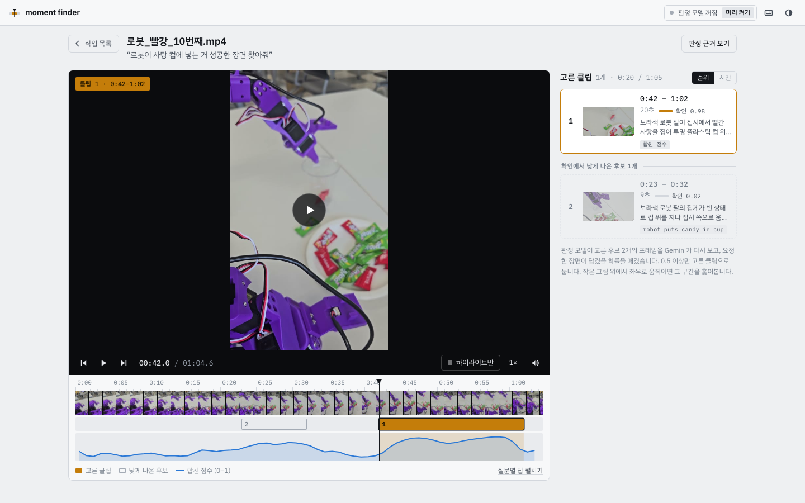

# Moment Finder — 한 줄로 적은 장면을 영상에서 찾아 클립으로

2026-2학기 자연어처리 프로젝트 1 (Jev 활용 프로젝트)

**바로 써 보기 → https://huggingface.co/spaces/kcyoow/moment-finder** (Hugging Face Space, ZeroGPU)

영상을 올리고 찾을 장면을 편하게 적으면, 그 장면이 담긴 대목만 클립으로 잘라 준다. 찾는 장면이 영상에 없으면 없다고 말한다.



## 왜 만들었나

유튜브 댓글에는 "3:42 ○○하는 장면"처럼 사람들이 직접 달아 둔 타임스탬프가 있다. 긴 영상에서 보고 싶은 장면을 찾는 일을 아직 사람 손이 하고 있다는 뜻이다. 이 일을 대신하고 싶었다.

이미 있는 하이라이트 도구는 대부분 말소리를 글로 옮긴 뒤 그 글에서 고른다. 말이 없는 영상에는 쓸 수 없다. 실습을 찍은 영상, 게임 화면, 운동 경기가 그렇다. 화면을 직접 봐야 한다.

그렇다고 영상 전체를 큰 모델에 넣고 "언제 그 일이 일어났나"를 물으면, 모델이 시각을 지어내기 쉽고 값도 비싸다. 그래서 반대로 했다. 영상을 1초 단위로 자르고, **글을 쓰지 못하는 작고 싼 판정 모델에게 "이 1초에 그 장면이 있나"를 예/아니오로만** 묻는다. 시각은 모델이 쓰지 않는다. 구간은 코드가 묶는다. 그래서 어디가 왜 뽑혔는지가 초 단위로 남는다.

어디에 쓰나:

- **실습·실험 녹화에서 되는 순간만 찾기.** 직접 찍은 로봇 실습 영상 25분에서, 미리 적어 둔 다섯 순간(사탕을 집어 컵에 넣는 데 성공한 때)이 모두 뽑힌 클립 안에 있었다
- **게임 녹화에서 특정 사건 찾기.** "크리퍼 나오는 장면"처럼 딱 집어 말한 것
- **없는 것을 없다고 알기.** 긴 영상을 끝까지 돌려 보지 않고도 "이 영상에는 그 장면이 없다"를 안다

## 어떻게 동작하나

```
"로봇이 사탕 컵에 넣는 거 성공한 장면 찾아줘" + 영상
   │
   ├─ ① 되묻기      중간 LLM(Qwen3.8-27B)이 요청을 읽고 "이렇게 찾을까요?" 하고 보여 준다
   │                찾을 장면 · 헷갈려서 빼려는 장면 · 1초마다 볼 것 (영상은 보지 않는다)
   ├─ ② 맞다 / 고쳐 말하기
   ├─ ③ 훑기        판정 모델(H2O-Lightning-4B)이 1초마다 프레임 4장을 보고 질문에 답한다 → 후보 6개까지
   ├─ ④ 다시 확인   같은 판정 모델이 후보마다 프레임 8장을 다시 본다
   │                "찾는 장면이 담겼나"(예/아니오) + "찾는 장면, 헷갈리는 장면, 어느 것도 아님 중 무엇인가"(고르기)
   └─ ⑤ 클립        둘 다 0.5 이상인 후보만 자른다. 없으면 없다고 말한다
```

영상을 보는 모델은 판정 모델 하나뿐이다. 중간 LLM은 요청 글만 본다. 중간 LLM이 요청을 어떻게 이해했는지는 화면에 그대로 보이고, 사용자가 맞다고 해야 다음으로 넘어간다.

## Jev를 어떻게 썼나

수업의 주제는 Jev, 곧 System 1 모델을 쓰는 것이다. Jev는 그림과 질문을 받아 **"예일 확률" 하나만** 돌려준다. 글을 쓰지 않으니 빠르고 싸고, 답이 숫자라 기준값으로 조절할 수 있다. 이 프로젝트의 뼈대(1초마다 예/아니오로 묻고, 구간은 코드가 묶는다)는 이 성질에서 나왔고 Jev로 처음 실험해 정했다.

- **Jev로 한 것.** 손하트를 찾는 첫 실험([1장](experiments/01_jev_feasibility/): 정밀도 0.95, 재현율 1.00), 프레임을 몇 장 어떻게 넣을지의 첫 실험들([2장](experiments/02_frames/)), 값과 속도 재기(10분 영상을 1초에 한 장씩 넣어 약 $0.03~0.10, 600장에 약 6초)
- **Jev에서 배워 끝까지 쓴 것.** 헷갈리는 것을 질문의 "아니오" 쪽에 적어 줘야 한다. 기준값은 0.5에서 시작해 질문마다 정한다. 질문을 늘려도 값은 거의 늘지 않고, 값을 정하는 것은 그림의 크기와 수다

### 왜 H2O-Lightning-4B로 옮겼나

Jev로 방식을 정한 뒤에는 공개 모델도 써 보고 싶었다. 가중치가 공개된 모델이면 직접 돌릴 수 있다. 실험을 마음껏 할 수 있고, 키 없이 누구나 열어 볼 수 있는 시연도 만들 수 있다.

그래서 Jev와 같은 System One 요청 형식(`/v1/systemone`. 질문의 종류가 예/아니오 noul, 점수 score, 고르기 choice 셋)으로 답하는 공개 가중치 모델 H2O-Lightning-4B로 옮겼다([모델 카드](https://huggingface.co/h2oai/h2o-lightning-4b)). 옮기기 전에 같은 프레임과 같은 질문으로 받아 둔 Jev의 답과 견줬다. 위치 찾기 100문항에서 Jev 89, H2O 86~88이었다([3장](experiments/03_open_model/)). 그 뒤에도 받아 둔 Jev의 답을 새 방식을 견주는 기준으로 썼다.

같은 형식이라 Jev에 묻던 질문을 거의 그대로 물을 수 있었고, Jev에서 배운 것도 그대로 가져왔다. 지금 Space에서 도는 것은 Jev가 아니라 H2O-Lightning-4B다.

## 써 보기

**1. Space에서** — 위 주소를 연다. 오래 쓰지 않았으면 모델을 올리느라 처음에 3~4분쯤 걸린다.

- "미리 돌려 둔 예시"를 누르면 GPU 없이 결과를 볼 수 있다
- 직접 돌리려면 영상(10분까지)을 올리고 요청을 적어 보낸다. 화면 아래의 예시 영상을 눌러 채워도 된다. 중간 LLM의 제안이 나오면 **이대로 찾기**를 누르거나 고칠 점을 적어 다시 보낸다
- 한 번에 GPU가 2~6분 든다(60초 영상 약 3분). ZeroGPU의 하루 한도는 로그인하지 않으면 2분, 무료 계정 5분, PRO 40분이다. 한도가 모자라면 중간에 멈추고, "이어서 하기"로 같은 곳부터 다시 한다

**2. 자기 계정에 복제해서** — Space 화면의 ⋮ → Duplicate this Space. 코드는 [`space/`](space/)에 있는 그대로다. ZeroGPU 하드웨어를 고른다.

**3. 로컬 웹사이트(앞선 판)** — [6장](experiments/06_pipeline_site/)의 사이트다. 판정 모델은 Modal에서, 질문 쓰기와 다시 확인은 Gemini가 한다. [uv](https://docs.astral.sh/uv/), Modal 계정, Vertex AI를 쓸 수 있는 gcloud 로그인이 있어야 한다. 돌리는 법은 [`pipeline/README.md`](pipeline/README.md)에 있다.



## 결과

같은 여섯 가지(영상, 요청)를 방식을 바꿔 가며 돌렸다. 장면이 있는 것이 셋, 없는 것이 셋이다. 로봇 영상은 직접 찍은 것이고 마인크래프트는 OpenAI VPT의 플레이 기록이다.

| 방식 | 보여 준 클립 | 그 가운데 맞는 것 |
|---|---|---|
| 다시 확인 없음 ([6장](experiments/06_pipeline_site/)) | 16 | 4 |
| Gemini가 질문을 쓰고 Gemini가 다시 확인 (6장의 웹사이트) | 5 | 5 |
| Gemini가 질문을 쓰고 H2O가 스스로 다시 확인 | 3 | 3 |
| Qwen이 쓰고 H2O가 찾고 H2O가 다시 확인 (공개 Space, 첫 실행) | 9 | 5 |
| 같은 흐름, Qwen에게 주는 안내 글을 고친 뒤 | 5 | 5 |

공개 모델 둘만으로 돌린 첫 실행은 틀린 클립이 4개 나왔다. 석탄이나 돌을 캐는 장면을 다이아몬드 채굴로 봤다. 중간 LLM이 "헷갈리는 장면"을 둘만 썼고 그 안에 평범한 채굴이 없었기 때문이다. "찾는 대상만 빠진 같은 동작"을 꼭 넣게 안내 글을 고치자 틀린 넷이 빠지고 맞는 다섯은 남았다.

마지막 줄은 조심해서 읽어야 한다. 같은 여섯 영상을 보고 고친 뒤에 같은 여섯으로 잰 것이고, 후보는 첫 실행의 것을 그대로 썼다. 새 영상에서도 같다는 뜻이 아니다. 자세한 것은 [9장](experiments/09_self_recheck/)에 있다.

## 가장 고민했던 것

2주 동안 부딪힌 것 가운데 방향을 바꾼 다섯 가지다. 나머지는 아래 "만든 과정"의 장마다 있다.

1. **멈춘 사진으로는 "집는다", "넣는다"를 알 수 없다.** 1초를 한 장, 4장, 2×2로 붙인 한 장, 8장을 줄인 한 장, 32칸 시트, 움직인 길을 그린 한 장으로 넣어 견줬다. 붙이면 싸질 줄 알았는데 토큰은 그대로였고 그림만 작아져 손과 물건이 뭉개졌다. 1초마다 4장을 따로 넣는 것으로 정했다([2장](experiments/02_frames/))
2. **Jev에서 공개 모델로 옮겨도 되는가.** Jev로 방식을 정한 뒤에는 공개 모델도 써 보고 싶었다. 직접 돌릴 수 있으면 실험을 마음껏 하고 키 없이 여는 시연도 만들 수 있다. 걱정은 모델을 바꾸면 그동안 Jev로 얻은 결론이 무효가 될 수 있다는 것이었다. 그래서 받아 둔 Jev의 답을 기준으로 놓고, 같은 프레임과 같은 질문에 다른 모델 셋의 답을 견줬다. 차이가 가장 작은 H2O-Lightning-4B로 옮겼다([3장](experiments/03_open_model/))
3. **찾는 장면이 없어도 클립이 나왔다.** 점수가 영상 안에서의 순위라 "가장 높은 곳"이 늘 있기 때문이다. 순위가 아니라 "이 후보에 그 장면이 담겼나"를 따로 묻는 다시 확인 단계를 넣었다. 맞는 클립이 16개 가운데 4개에서 5개 가운데 5개가 됐다([6장](experiments/06_pipeline_site/))
4. **결과가 계속 나쁘게 나왔는데, 틀린 것은 방법이 아니라 정답이었다.** 마인크래프트의 정답은 게임 기록에서 만든 "큰 사건"이었다. 쪼개 보니 56곳 가운데 43곳이 도구 제작과 동물 사냥이었고, 사람이 하이라이트로 칠 만한 것은 13곳이었다. 무엇을 재고 있는지부터 봐야 했다([5장](experiments/05_vague_highlight/))
5. **바깥 API를 떼어 내니 틀린 클립이 다시 나왔다.** Gemini를 빼고 공개 모델 둘만으로 돌린 최종 시험은 미리 정한 기준에 못 미쳤다. 원인은 헷갈리는 장면을 누가 얼마나 잘 쓰느냐였고, 값을 아끼려고 그 수를 줄인 내 선택도 한몫했다. 안내 글을 고쳐 다시 쟀고, 고치기 전의 결과도 그대로 적었다([9장](experiments/09_self_recheck/))

## 만든 과정

실험은 대부분 무엇을 보고 어떻게 읽을지를 결과보다 먼저 적고 했다. 장마다 그때의 물음과 한 일, 나온 것과 그 까닭이 있다.

| 장 | 물음 | 나온 것 |
|---|---|---|
| [1. 판정 모델로 되나](experiments/01_jev_feasibility/) | 예/아니오로만 답하는 모델(Jev)로 영상 속 장면을 찾을 수 있나 | 된다(정밀도 0.95, 재현율 1.00). 헷갈리는 것을 질문에 적어 줘야 한다. 임베딩 유사도로는 안 된다 |
| [2. 프레임을 어떤 모양으로](experiments/02_frames/) | 1초를 어떻게 보여 줄까: 한 장, 4장, 붙이기, 시트, 움직인 길 | 1초마다 4장을 따로 넣는 것이 가장 낫다. 붙이면 작아져서 못 본다 |
| [3. 공개 모델로 바꾸기](experiments/03_open_model/) | 공개 모델로 옮겨도 Jev로 얻은 결론이 그대로인가 | H2O-Lightning-4B가 Jev와 구별되지 않는다(차이 −0.01) |
| [4. 질문 문장 다듬기](experiments/04_prompt_study/) | 문장을 바꾸면 덜 헛짚나 | 따로 둔 영상에서 재현된 문장이 없다. 문장보다 기준값이다 |
| [5. 막연한 요청](experiments/05_vague_highlight/) | "하이라이트 뽑아줘"에는 무엇을 물어야 하나 | 구체적으로 물으면 낫다. LLM이 질문을 쓸 수 있다. 그런데 정답부터가 사람마다 다르다 |
| [6. 흐름과 웹사이트](experiments/06_pipeline_site/) | 한 줄로 이으면 쓸 만한가. 없는 장면에 없다고 말하나 | 다시 확인 단계를 넣어 맞는 클립이 16개 중 4개 → 5개 중 5개 |
| [7. 소리와 넣는 모양 다시](experiments/07_sound_and_layout/) | 소리를 더하면? 맥락을 더 넣으면? 더 큰 모델이면? | 셋 다 나아지지 않았다. 가장 크게 움직인 것은 "정의를 써 주기"였다 |
| [8. ZeroGPU Space](experiments/08_space_qwen/) | 바깥 API 없이 공개 모델만으로 돌릴 수 있나 | Qwen3.8-27B-FP8과 H2O를 한 GPU에 올렸다. 대화로 되묻는다 |
| [9. 스스로 다시 확인, 최종 시험](experiments/09_self_recheck/) | 다시 확인도 같은 판정 모델이 할 수 있나 | 정의를 주고 헷갈리는 장면과 함께 고르게 하면 된다. 헷갈리는 장면을 잘 쓰는 것이 결과를 가른다 |
| [부록. 유사도 방식](experiments/appendix_platonic_align/) | 논문의 영상·글 정렬로 대신할 수 있나 | 재현은 됐지만 보태면 나빠졌다 |

## 한계

- **후보 여섯에 없는 장면은 못 찾는다.** "찾는 장면이 보이지 않습니다"는 "후보 가운데 없다"는 뜻이다
- **엄하게 거른다.** 틀린 클립을 보여 주지 않는 쪽으로 맞춰서, 맞는 클립도 일부 빠진다
- **1초보다 짧은 순간, 그리고 소리로만 알 수 있는 장면**은 못 찾는다. 화면만 본다
- **막연한 요청("하이라이트")은 결과를 잴 정답이 없다.** 그래서 중간 LLM이 어떻게 이해했는지를 먼저 보여 주고 사용자가 고치게 했다
- **시험한 영상이 적다.** 최종 시험은 여섯 가지이고, 안내 글을 고친 뒤의 값은 같은 여섯으로 다시 잰 것이다
- **중간 LLM은 검색하지 않는다.** "마크 영상"의 "마크"를 사람 이름으로 읽은 적이 있다. 그래서 어떻게 이해했는지를 먼저 보여 준다
- **느리다.** 중간 LLM이 계획을 쓰는 데 GPU 1~2분이 들고, 방문자의 하루 한도 안에서 끝나지 않을 수 있다

## 이 문서에서 쓰는 말

| 말 | 뜻 |
|---|---|
| 판정 모델 | 그림 몇 장과 질문 하나를 받아 "예일 확률"(또는 점수, 선택지별 확률)만 내는 작은 모델. Jev, H2O-Lightning-4B |
| 중간 LLM | 사용자의 요청을 판정 모델에 물을 질문으로 바꿔 쓰는 모델. 영상은 보지 않는다 |
| 후보 | 1초마다의 점수가 높아 클립이 될 뻔한 구간. 다시 확인을 통과해야 클립이 된다 |
| 다시 확인 | 후보 하나하나에 "그 장면이 정말 담겼나"를 따로 묻는 단계 |
| AUC | 맞는 초가 아닌 초보다 높은 점수를 받는 비율. 1이면 완전하고 0.5면 무작위다 |
| 한 곳 찾기 | 질문마다 점수가 가장 높은 한 곳이 정답 구간 안에 드는지를 센 것(100문항 가운데 몇 개) |

## 폴더

| 자리 | 내용 |
|---|---|
| [`space/`](space/) | 공개 Space의 코드. `app.py`(모델 올리기), `engine.py`(흐름과 화면), `plan.py`(중간 LLM의 계획), `examples/`(예시 영상과 미리 돌려 둔 결과) |
| [`pipeline/`](pipeline/) | 6장의 흐름과 로컬 웹사이트. `mf.py`(프레임·클립), `mf_core.py`(점수 합치기·클립 규칙), `mf_writer.py`(질문 쓰기), `mf_recheck.py`(다시 확인), `mf_serve_modal.py`(판정 모델 앱), `web/`(웹사이트) |
| [`experiments/`](experiments/) | 장마다 폴더 하나. `README.md`가 보고서이고 `code/`에 그때의 스크립트, `img/`에 그림이 있다 |
| [`docs/`](docs/) | `DECISION_PROMPT_GUIDE.md`(판정 모델에 보낼 질문을 쓰는 법. 실험에서 얻은 것을 정리해 중간 LLM에게 준다), 화면 그림 |

받은 영상과 뽑은 프레임, 모델의 답 원자료는 용량과 라이선스 때문에 싣지 않았다(Charades와 TVSum의 사람 점수는 다시 배포할 수 없다). `code/`의 스크립트는 그때 쓴 그대로이고 계정 이름만 `<modal-profile>`, `<gcp-project>`로 바꿨다. 자료 폴더가 없어 그대로는 돌지 않는 것이 많다.

## 쓴 모델과 자료

| | 이름 | 라이선스·조건 |
|---|---|---|
| 판정 모델 | [h2oai/h2o-lightning-4b](https://huggingface.co/h2oai/h2o-lightning-4b) (처음에는 TypeSafe Jev 1.14.0) | Apache-2.0 |
| 중간 LLM | [Qwen/Qwen3.8-27B-FP8](https://huggingface.co/Qwen/Qwen3.8-27B-FP8) (6장에서는 Gemini 4 Hydrogen) | 모델 카드 참고 |
| 영상 | 직접 찍은 로봇 실습 영상 | — |
| 영상 | [OpenAI VPT](https://github.com/openai/Video-Pre-Training) 마인크래프트 플레이 기록 | MIT |
| 영상 | [Charades](https://prior.allenai.org/projects/charades), [TVSum](https://github.com/yalesong/tvsum) | 비상업 연구용. 영상·프레임·사람 점수는 싣지 않음 |
