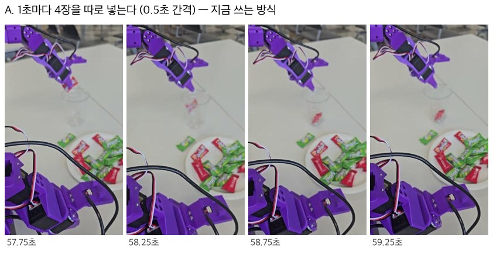
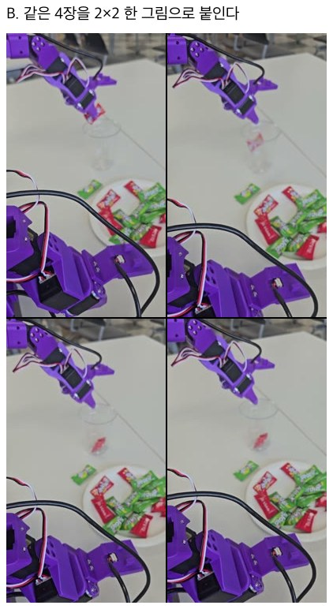
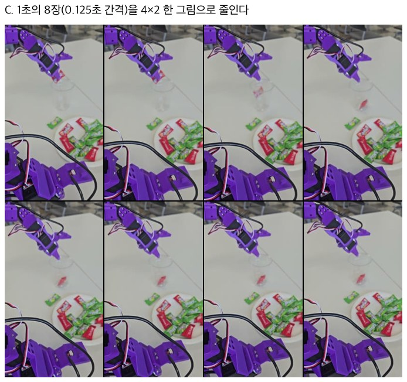
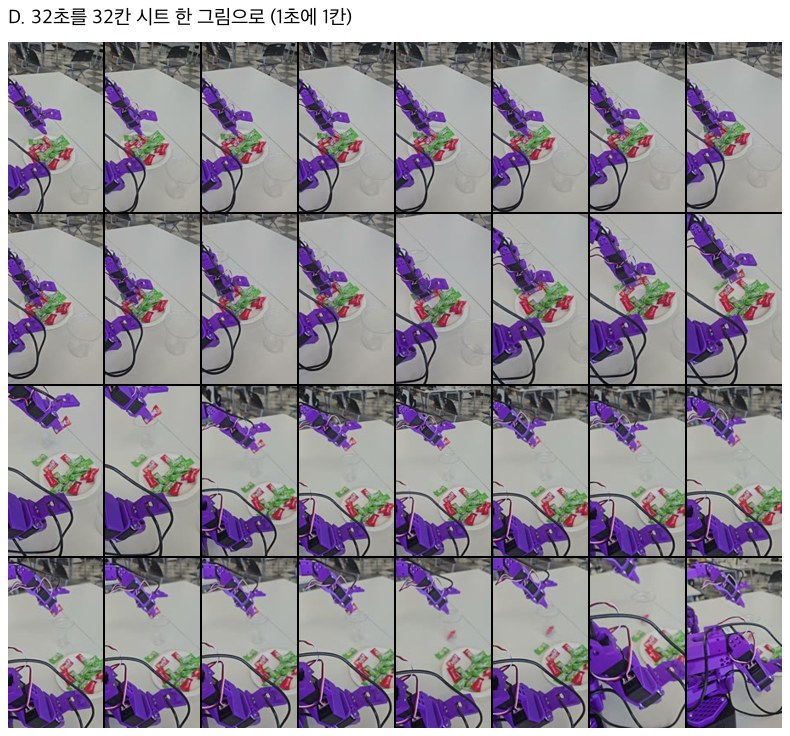
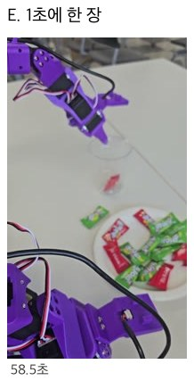

# 2. 판정 모델에 프레임을 어떤 모양으로 보여 줄까

2026-11-10 ~ 11-14 · 판정 모델 Jev → H2O-Lightning-4B · 자료: Charades(사람 동작), 마인크래프트 플레이 기록(OpenAI VPT)

## 붙이면 싸지지 않을까

멈춘 사진 한 장으로는 "문을 연다"와 "문이 열려 있다"를 가를 수 없다. 그래서 1초를 여러 장으로 보여 줘야 하는데, 판정 모델은 요청 하나에 그림을 4장까지만 받고 그림이 많을수록 값이 오른다. 여러 장을 한 그림으로 붙여 넣으면 같은 값에 더 많이, 더 촘촘히 보여 줄 수 있지 않을까 하는 것이 출발이었다. 이 장의 실험은 대부분 그 기대를 하나씩 확인한 것이다.

## 견준 모양들

같은 영상, 같은 질문에 넣는 모양만 바꿨다. 아래 그림은 모양을 보이려고 직접 찍은 로봇 영상으로 다시 만든 것이다(실험에 쓴 Charades 영상은 다시 배포할 수 없어 싣지 않았다).

| 모양 | 예 |
|---|---|
| A. 1초마다 4장을 따로 (0.5초 간격) |  |
| B. 같은 4장을 2×2 한 그림으로 |  |
| C. 1초의 8장을 4×2 한 그림으로 |  |
| D. 32칸 시트 (1초에 1칸) |  |
| E. 1초에 한 장 |  |

여기에 하나를 더 해 봤다. 한 장에 그 1초 동안 물체가 움직인 길(점을 따라간 경로)을 그려 넣는 방식이다. 프레임을 모두 넣고 경로를 덧그리는 논문(Motion-as-Prompt)의 생각을 "한 장 + 경로"로 줄인 우리 쪽 변형이다.

재는 자료는 둘이었다.

- **Charades**: 사람이 집 안에서 하는 동작. 영상 30편, 질문 100개. "한 곳 찾기"는 점수가 가장 높은 위치가 정답 구간 안에 드는 질문의 수다(100개 가운데)
- **마인크래프트**: 5분 조각 22편. 인벤토리 창이 열린 구간 90개가 게임 기록에 틱 단위로 남아 있어 정답이 정확하다. 가장 짧은 것은 0.3초다

## 나온 것

| 넣는 모양 | Charades 한 곳 찾기 (100) | 마인크래프트 창 열림 (90) | 요청당 토큰 |
|---|---|---|---|
| A. 4장 따로 | **88** | 87~88 | 1,290~1,646 |
| B. 2×2 한 그림 | 83 (차이 −0.05, 95% 구간 −0.117 ~ +0.022) | — | 1,582 |
| C. 8장 한 그림 | 76 | **90** | 1,339 |
| D. 32·60칸 시트 | 63~69 | — | 1초당 119~854 |
| E. 1초에 한 장 | — | 74 | 403 |

경로를 그린 한 장은 동작 구간 안팎을 가르는 AUC가 0.664~0.671로, 그냥 한 장(0.672)과 같았다. 같은 1초의 4장 따로는 0.733이었다.

기대는 대부분 빗나갔다. 붙여도 싸지지 않았고(2×2의 토큰 1,582 대 따로 1,646), 사람 동작에서는 붙일수록 나빠졌다. 붙인 쪽이 이긴 곳은 마인크래프트의 창 열림 하나였다.

## 왜 이렇게 갈렸나

두 자료가 요구하는 것이 달랐다고 본다. 사람 동작은 손과 물건이 보여야 하는데, 붙이면 한 장이 작아져 그것이 뭉개진다. 반대로 인벤토리 창은 화면 가득 뜨니 작아져도 보이고, 0.3초짜리는 0.5초 간격으로는 사이로 빠지니 촘촘한 쪽이 유리하다. 같은 "8장 한 그림"이 한쪽에서는 가장 좋고 다른 쪽에서는 나쁜 까닭이다.

붙여도 값이 그대로인 것은 이 모델이 그림의 넓이만큼 토큰을 쓰기 때문으로 보인다. 4장을 붙인 한 장은 4장만큼 넓다.

경로 그림은 모델에 넣기 전부터 가망이 없었다. 경로만으로 동작 구간 안팎을 가르는 AUC가 0.565~0.569였다(0.5가 무작위).

## 정한 것

**A(1초마다 4장 따로)로 정했다.** 찾으려는 것이 대부분 사람이나 물건의 움직임이기 때문이다. 이 뒤의 모든 실험과 웹사이트, Space가 이 모양을 쓴다. 화면에 크게 뜨는 짧은 사건만 따로 다룰 때는 C가 낫다는 것은 적어만 두었다.

이 실험들을 하던 중에 판정 모델을 공개 모델로 옮겼다 → [3장](../03_open_model/)

코드: [`code/frame_limit/`](code/frame_limit/)(Jev 때의 첫 실험들), [`code/grid4/`](code/grid4/), [`code/mc_dense/`](code/mc_dense/), [`code/charades_dense/`](code/charades_dense/), [`code/traj_mark/`](code/traj_mark/)

자료: [Charades](https://prior.allenai.org/projects/charades)(비상업 연구용. 영상과 프레임은 싣지 않음), [OpenAI VPT](https://github.com/openai/Video-Pre-Training)(MIT)
