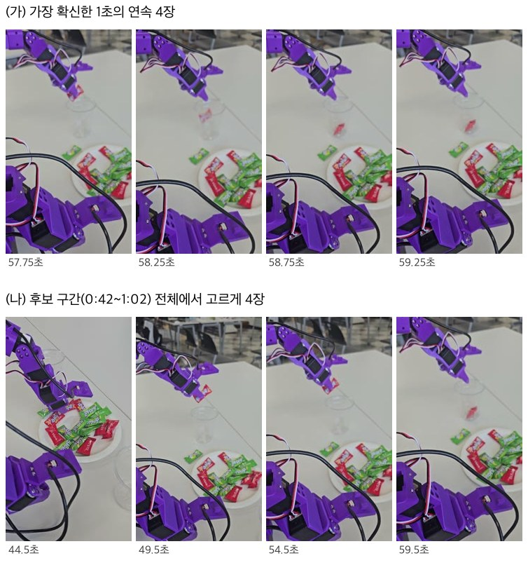
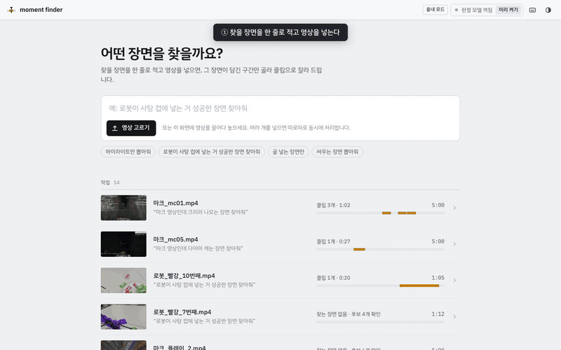
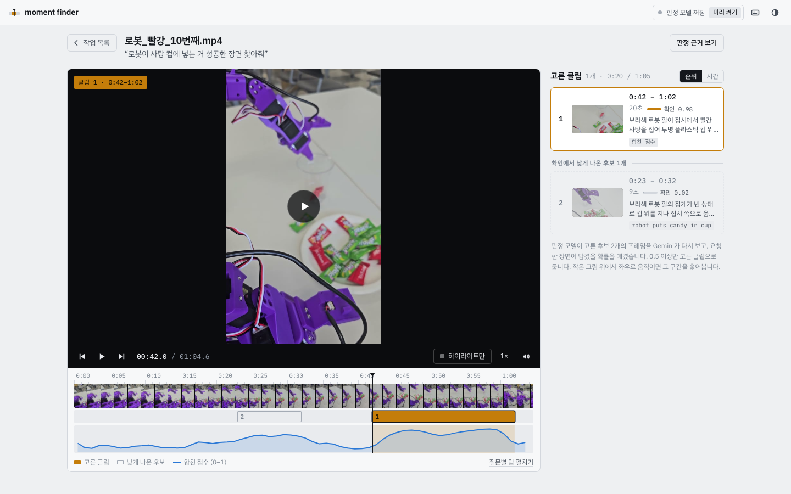
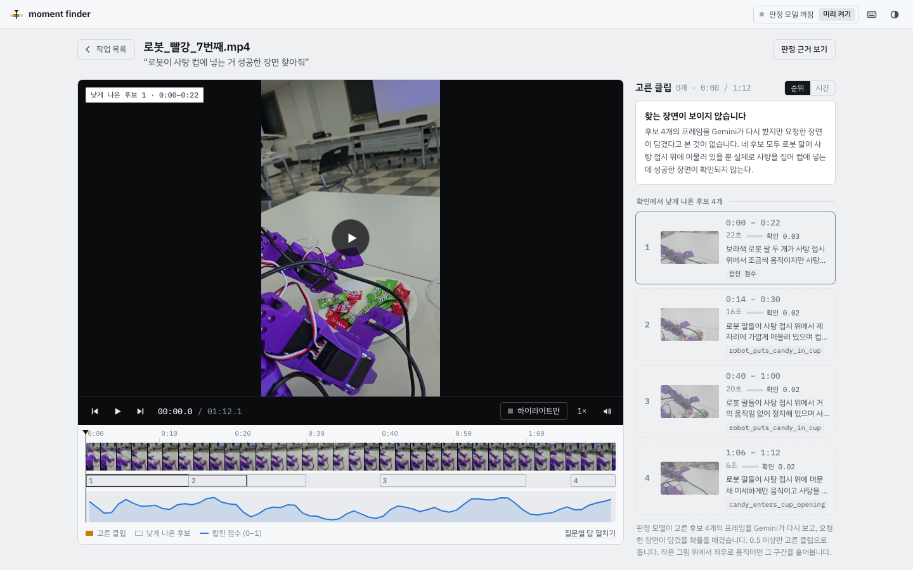

# 6. 흐름으로 묶고 웹사이트로 만들기

2026-11-16 · 판정 모델 H2O-Lightning-4B(Modal) · 질문 쓰기와 다시 확인 Gemini 4 Hydrogen · 코드 [`pipeline/`](../../pipeline/)

## 조각은 있는데 이어 본 적이 없었다

여기까지 정한 것은 조각들이었다. 1초마다 4장을 넣는다, 구체적으로 묻는다, 질문은 LLM이 쓴다. 이것을 한 줄로 이었을 때 실제 영상에서 쓸 만한 클립이 나오는지는 해 봐야 알았다. 그리고 이어 보자마자 생각지 못한 문제가 나왔다. **찾는 장면이 영상에 없는데도 클립이 나왔다.**

## 흐름

```
요청 한 줄 + 영상
   ├─ ① 질문 쓰기   LLM이 요청을 질문 3~5개로 바꾼다 (영상은 보지 않는다)
   ├─ ② 프레임      1초마다 4장(0.5초 간격)
   ├─ ③ 판정        판정 모델이 1초마다 모든 질문에 답한다
   ├─ ④ 합치기      질문들의 답 + "이 순간이 요청에 맞나"(막연한 질문 하나)를 반반 합쳐 1초마다 점수 하나
   ├─ ⑤ 후보        점수가 높은 곳을 앞뒤로 넓혀 구간으로. 여섯 개까지
   ├─ ⑥ 다시 확인   후보마다 프레임 8장을 다른 눈으로 다시 본다
   └─ ⑦ 클립        통과한 후보만 자른다. 통과한 것이 없으면 없다고 말한다
```

처음부터 이 모양은 아니었다. ①~⑤와 ⑦만 있었고, 아래의 문제들을 하나씩 만나며 지금 모양이 됐다.

| 부딪힌 것 | 한 것 |
|---|---|
| 점수가 높은 초를 그대로 자르면 1~2초짜리 조각이 된다 | 높은 곳에서 앞뒤로 넓히고, 한 칸 끊긴 곳은 잇고, 앞 2초·뒤 1초를 붙였다 |
| LLM의 질문이 빗나가면 결과가 통째로 빗나간다 | 요청 문장을 그대로 넣은 막연한 질문 하나를 늘 함께 물어 점수의 절반을 받치게 했다 |
| 찾는 장면이 없어도 클립이 나온다 | ⑥ 다시 확인 단계를 넣었다 |
| 후보에 없는 장면은 확인해도 못 살린다 | 후보를 합친 점수에서만 뽑지 않고 질문마다 돌아가며 뽑았다(후보에 드는 사건 23 → 34곳) |
| 영상 셋을 동시에 넣으니 둘이 실패했다 | GPU 없는 시험 앱으로 원인을 재현했다(한 영상이 파일을 연 채로 다른 영상이 저장소를 다시 읽음). 읽고 적는 동안 줄을 세웠다 |

## 없는데도 나오는 클립

셋째 줄이 가장 오래 걸렸다. 점수는 영상 안에서의 순위다. 그래서 영상에 그 장면이 있든 없든 "가장 높은 곳"은 늘 있고, 그곳이 클립이 된다. 사탕을 집지도 않은 로봇 영상에서 "성공한 장면"이 나왔다.

숫자를 다듬는 것으로 풀어 보려 했다. 주변과 견줘 튀는 곳만 살리기, 답들이 서로 맞는지로 가늠하기 같은 것을 받아 둔 답으로 해 봤지만, 기본값으로 삼을 만큼 나아진 것이 없었다. 결국 문제를 바꿨다. "이 영상에서 가장 그럴듯한 곳은 어디인가"가 아니라 **"이 후보에 그 장면이 담겼나"**를 후보마다 따로 묻는 것이다. 후보가 여섯뿐이라 이 단계에는 큰 모델(Gemini)을 써도 쌌다. 돌리기 전에 이 방식이 가장 잘됐을 때 얼마나 나아질 수 있는지(상한)를 먼저 계산했고, 읽는 법도 정해 두었다.

다시 확인이 보는 프레임 8장은 이렇게 고른다.



## 나온 것

웹사이트에 실제로 넣은 여섯 가지(영상, 요청):

| 영상 · 요청 | 영상에 실제로 있는 것 | 다시 확인이 없었다면 | 다시 확인을 넣은 뒤 |
|---|---|---|---|
| 로봇(65초) · "사탕 컵에 넣는 거 성공한 장면" | 59초에 사탕이 컵에 들어감 | 클립 1개 (맞음) | 0:42~1:02 하나 |
| 로봇(72초) · 같은 요청 | 집으려는 시도가 없음 | 클립 1개 (틀림) | "찾는 장면이 보이지 않습니다" |
| 마인크래프트 · "다이아 캐는 장면" | 1:44~1:48에 다이아몬드를 캠 | 클립 4개 (하나만 맞음) | 1:27~1:54 하나 |
| 마인크래프트 · "크리퍼 나오는 장면" | 2:34~3:53쯤에 크리퍼가 보임 | 클립 3개 (둘 맞음) | 크리퍼가 보이는 대목 셋 |
| 마인크래프트 · "싸우는 장면" | 싸움 없음 | 클립 4개 (모두 틀림) | "찾는 장면이 보이지 않습니다" |
| 마인크래프트 · "다이아 캐거나 크리퍼 만나거나 위험한 장면" | 셋 다 없음 | 클립 3개 (모두 틀림) | "찾는 장면이 보이지 않습니다" |

다시 확인이 없었다면 클립 16개 가운데 4개만 맞았다. 넣은 뒤에는 통과한 5개가 모두 맞았다(프레임을 직접 봤다). 직접 찍은 로봇 실습 영상 두 편(15분, 9분)에서는 미리 적어 둔 다섯 순간이 모두 클립 안에 들었다(AUC 0.951, 0.998).



*웹사이트가 돌아가는 모습. 처리 중 장면은 받아 둔 답으로 흉내 내어 빨리 감은 것이고, 결과 화면은 같은 영상과 요청을 실제로 돌린 것이다.*





## 다시 확인도 믿을 수만은 없다

같은 구간을 두 번 물은 49쌍에서 다시 확인의 답은 대체로 같았다(순위 상관 0.934). 그런데 한 장면이 뒤집혔다. 협곡을 내려다보는 대목을 "위험한 장면"이냐고 물었을 때 한 번은 0.85, 한 번은 0.15가 나왔다. 사람이 봐도 애매한 장면이다. 그래서 낮게 나온 후보를 지우지 않고 흐리게 따로 보여 주게 했다. 모델이 뺀 것을 사람이 다시 볼 수 있어야 한다고 봤다.

판정 모델이 닮은 것을 가르지 못한다는 것도 여기서 분명해졌다. "컵에 넣는다"와 "컵 쪽으로 옮긴다", 붉은 광석 조각과 싸움의 피해 표시를 같은 것으로 봤다.

## 다음으로

이 흐름이 로컬 웹사이트가 됐다([`pipeline/web/`](../../pipeline/web/)). 화면은 두 번 다시 만들었다. 첫 판은 흔한 템플릿 같았고 둘째 판은 한 화면에 너무 많은 것을 담았다. 지금은 처음 화면에 할 일 하나와 작업 목록만 있다. 영상을 여러 개 넣으면 따로따로 동시에 처리한다.

남은 것이 둘 있었다. 소리를 쓰지 않는다는 것([7장](../07_sound_and_layout/)), 그리고 질문 쓰기와 다시 확인이 바깥 API(Gemini)에 기대고 있다는 것이다([8장](../08_space_qwen/), [9장](../09_self_recheck/)).
