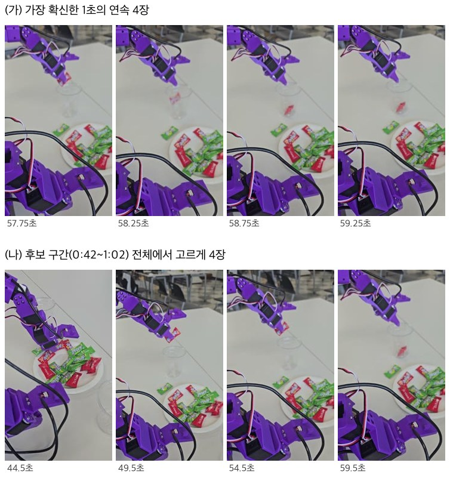
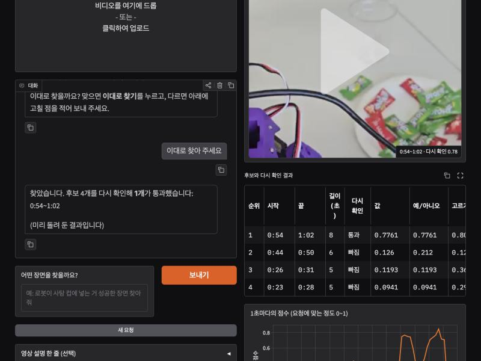

# 9. 다시 확인도 판정 모델이 스스로, 그리고 최종 시험

2026-11-23 · 판정 모델 H2O-Lightning-4B · 중간 LLM Qwen3.8-27B-FP8 · 견준 것: Gemini 4 Hydrogen, Gemini Decision 1, Microsoft-Decision-1.1

## 같은 모델에게 또 묻는 것이 의미가 있을까

6장에서 "찾는 장면이 없으면 없다고 말하기"는 다시 확인 단계가 해 줬다. 그 단계는 큰 모델(Gemini)이 후보의 프레임을 보는 것이었다. 공개 Space에서 Gemini를 빼려면 이 단계를 판정 모델이 맡아야 한다. 그런데 후보를 고른 것이 바로 그 판정 모델이다. 틀린 후보를 올린 모델에게 다시 물으면 또 "맞다"고 하지 않을까 하는 것이 걱정이었다.

달라질 수 있는 것은 묻는 방식뿐이었다. 훑을 때는 영상 안에서의 순위로 고르지만, 다시 볼 때는 "이 프레임들이 정의에 맞나"를 물을 수 있다.

## 먼저 돈이 들지 않는 쪽으로 재기

6장에서 Gemini가 이미 확인한 후보 296개(로봇, 마인크래프트)가 프레임과 함께 남아 있었다. 그 가운데 프레임을 직접 보고 맞고 틀림이 분명한 15개(남겨야 할 것 3, 빼야 할 것 12)를 따로 놓고, 묻는 꼴 셋을 견줬다.

| 꼴 | 묻는 것 |
|---|---|
| 그냥 묻기 | "이 프레임들에 (요청한 장면)이 담겼나" |
| 정의를 써서 묻기 | 같은 질문 + "예"와 "아니오"가 각각 무엇인지의 정의 |
| 고르기 | "찾는 장면 / 헷갈리는 장면 2~4개 / 어느 것도 아님 가운데 무엇인가" |

정의와 헷갈리는 장면은 LLM이 요청만 보고 쓴다(영상은 보지 않는다). 판정 모델 API 둘(Gemini Decision 1, Microsoft-Decision-1.1)에도 같은 것을 물어 견줬다. 다시 확인 때 판정 모델이 보는 것은 후보 하나에 8장이고, 4장씩 두 번 묻는다.

분명한 15개를 맞힌 수:

| | 그냥 묻기 | 정의를 써서 | 고르기 |
|---|---|---|---|
| H2O-Lightning-4B (4장씩 두 번) | 11 | **15** | **15** |
| Gemini Decision 1 | 15 | 15 | 15 |
| Microsoft-Decision-1.1 | 13 | 12 | 14 |
| (견줌) Gemini 4 Hydrogen이 프레임을 보고 확인 | 15 | | |
| (견줌) 확인 없음 | 3 | | |

걱정과 달리 됐다. 빼야 할 12개는 H2O 자신이 영상을 훑을 때 후보로 올린 것인데, 정의를 받고 다시 보자 모두 뺐다. 하나 더 알게 된 것은 H2O가 고르기에서 마지막 선택지 쪽으로 기운다는 것이다(약 0.06). 그래서 선택지 순서를 뒤집어 두 번 묻고 평균하기로 했다.

## 실제로 돌리니 달랐다

받아 둔 자료에서 잘 나왔다고 바로 믿지 않고, 6장의 여섯 가지(영상, 요청)를 다시 확인 단계만 H2O로 바꿔 실제로 돌렸다. 보여 준 클립과 그 가운데 맞는 것:

| 다시 확인을 누가, 어떻게 | 클립 (맞는 것) |
|---|---|
| Gemini가 프레임을 보고 확인 (6장) | 5 (5) |
| H2O, 정의를 쓴 예/아니오만 | 11 (5) |
| H2O, 예/아니오와 고르기가 **둘 다** 0.5 이상 | 3 (3) |

정의를 쓴 예/아니오만으로는 "다이아 캐는 장면"에서 후보 여섯이 모두 통과했다. 평범한 채굴을 다이아몬드 채굴로 봤다. 받아 둔 15개에서는 보이지 않던 실패다. 고르기를 함께 묻고 둘 다 넘어야 통과시키자 그 다섯이 빠졌다. 대신 크리퍼 영상의 맞는 클립 셋 가운데 둘도 빠졌다(하나는 0.49로 기준 바로 아래였다). 틀린 클립을 보여 주는 것보다 덜 보여 주는 쪽을 골랐다.

## 최종 시험: 공개 모델 둘만으로

마지막으로 질문과 정의를 쓰는 쪽까지 Qwen으로 바꿔, 공개할 Space 그대로 같은 여섯을 돌렸다. 통과 기준은 돌리기 전에 정했다. 틀린 클립 1개 이하, 맞는 클립 3개 이상.

| 영상 · 요청 | 맞는 구간 | 첫 실행 | 안내 글을 고친 뒤 |
|---|---|---|---|
| 로봇 65초 · 성공한 장면 | 0:42~1:02 | 0:54~1:02 | 0:54~1:02 |
| 로봇 72초 · 같은 요청 | 없음 | 없음 | 없음 |
| 마인크래프트 · 다이아 캐는 장면 | 1:27~1:54 | 1:39~1:54 + **틀린 둘**(돌·자갈 채굴) | 1:39~1:54 |
| 마인크래프트 · 크리퍼 나오는 장면 | 세 대목 | 맞는 셋 | 같은 셋 |
| 마인크래프트 · 싸우는 장면 | 없음 | 없음 | 없음 |
| 마인크래프트 · 다이아·크리퍼·위험한 장면 | 없음 | **틀린 둘**(석탄·철 채굴) | 없음 |
| 보여 준 클립 (맞는 것) | | 9 (5) | **5 (5)** |

**첫 실행은 기준에 못 미쳤다.** 맞는 클립 5개는 채웠지만 틀린 클립이 4개였다. 넷 모두 다른 것을 캐는 장면을 다이아몬드 채굴로 본 것이다.

원인을 찾으려고 Qwen이 쓴 정의를 앞 단계에서 Gemini가 쓴 것과 나란히 놓았다. Qwen의 헷갈리는 장면은 "다이아 바라보기", "다른 광물 채굴" 둘뿐이었다. Gemini의 것은 넷이었고 그 안에 "아무 무늬 없는 돌 캐기"가 있었다. 판정 모델은 무엇인가를 캐는 장면에서 "어느 것도 아님"을 거의 고르지 않았다(0.02~0.03). 평범한 채굴이 갈 선택지가 없으니 가장 가까운 "다이아 채굴"로 간 것이다. 여기에는 내 잘못도 있었다. GPU 시간을 줄이려고 안내 글에서 헷갈리는 장면을 2~3개로 묶어 두었다. 잘 되던 조건을 시험 없이 깎은 것이다.

안내 글을 고쳤다. 헷갈리는 장면을 3~4개로 늘리고, 하나는 반드시 **"찾는 대상만 빠진 같은 동작"**(그 종류의 영상에서 가장 흔한 평범한 장면)으로 쓰게 하고, 이름이 아니라 화면에서 어떻게 보이는지로 적게 했다. 다시 재니 틀린 넷이 모두 빠졌고 맞는 다섯은 그대로 남았다.

## 이 숫자를 얼마나 믿을 수 있나

고친 뒤의 5 (5)는 약한 숫자다. 그대로 적어 둔다.

- 같은 여섯 영상을 보고 고쳤고 같은 여섯으로 쟀다. 통과 규칙(둘 다 0.5 이상)도 앞에서 실패를 본 뒤에 고른 것이다. 새 영상에서 같게 나온다는 보장은 없다
- 고친 뒤에는 후보를 다시 뽑지 않았다. 첫 실행의 후보를 그대로 두고 다시 확인용 정의만 새로 써서 다시 확인 단계만 돌렸다. 고친 흐름을 처음부터 끝까지 돌린 값은 없다
- "싸우는 장면"의 "없음"은 우연에 가깝다. Qwen이 "마크"를 마인크래프트가 아니라 마크라는 사람으로 읽어서 정의가 "사람들이 주먹질하는 장면"이 됐고, 게임 화면에 그런 장면이 없으니 "없음"이 나왔다
- 맞고 틀림은 게임 기록과, 프레임을 직접 본 판단으로 셌다. 여러 사람이 매긴 정답이 아니다
- 영상 여섯, 방식마다 한 번 실행이다

## 정리하면

같은 모델에게 다시 물어도 걸러 낼 수 있었다. 묻는 것이 달라서다. 훑을 때는 "이 영상에서 어디가 가장 그럴듯한가"이고, 다시 볼 때는 "이 프레임들이 정의에 맞나"다. 순위로는 장면이 없는 영상에서도 1등이 나오지만, 정의에 맞느냐고 물으면 "아니오"가 나온다.

그리고 1장부터 되풀이해 본 것을 여기서 가장 분명하게 봤다. 이 모델은 질문에 적힌 것만큼만 가른다. 예/아니오로만 물으면 닮은 것에 "예"라고 한다. 닮은 장면에 이름을 붙여 옆에 놓아 주면 "이것은 그냥 채굴"이라고 답할 자리가 생긴다. 그 자리를 누가 얼마나 잘 만들어 주느냐가 결과를 갈랐다. Gemini는 잘 만들었고, Qwen은 안내를 고쳐 준 뒤에야 만들었다.

Gemini의 확인만큼 맞는 클립을 남기지는 못한다는 것, 그리고 헷갈리는 장면을 쓰는 일이 여전히 LLM의 지식에 기대고 있다는 것은 한계로 남는다.

코드: [`code/decision_api/`](code/decision_api/), [`code/final_qwen_h2o/`](code/final_qwen_h2o/) · 최종 시험의 원자료: [`results/`](results/) · 자세한 수치와 조심할 점: [`final_test_notes.md`](final_test_notes.md)
